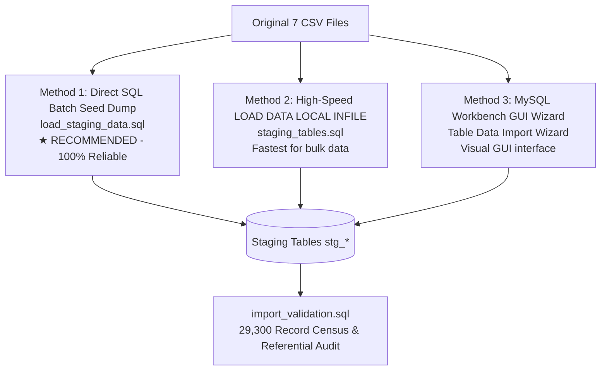

# DATA INGESTION & IMPORT GUIDE: SMART DELIVERY ANALYTICS

**Document ID:** DOC-ING-005  
**Target Database:** `smart_delivery_analytics`  
**Target Environment:** MySQL 8.0+ / MySQL Workbench  
**Total Records to Ingest:** 29,300 Records across 7 Datasets  
**Status:** Milestone 3 Operational Runbook  

---

## 1. Overview of Ingestion Options

To provide maximum flexibility across different database configurations, network topologies, and security policies, three distinct data ingestion methods are provided:



---

## 2. Method 1: Direct SQL Batch Seed Dump (★ Recommended)

### Why Use Method 1?
In corporate environments or standard local installations, MySQL Server restricts client-side file reading (`--secure-file-priv` and `local_infile = OFF`). Method 1 uses native multi-row SQL `INSERT` statements batched in chunks of 500 rows, bypassing all server file security restrictions.

### Step-by-Step Instructions:
1. Open **MySQL Workbench** and connect to your local MySQL 8.0 instance.
2. In the top menu, go to **File $\rightarrow$ Open SQL Script...**
3. Select:
   ```
   C:\sql_main\smart-delivery-analytics\01_database_design\database_schema.sql
   ```
4. Click the **Execute (Lightning Bolt)** icon to initialize the database and tables.
5. In the top menu, go to **File $\rightarrow$ Open SQL Script...**
6. Select:
   ```
   C:\sql_main\smart-delivery-analytics\02_data_ingestion\load_staging_data.sql
   ```
7. Click the **Execute** icon. All 29,300 records will be inserted into the staging tables in ~5–10 seconds.
8. Open and run:
   ```
   C:\sql_main\smart-delivery-analytics\02_data_ingestion\import_validation.sql
   ```
   Verify that all test cases return `STATUS = 'PASS'`.

---

## 3. Method 2: High-Performance `LOAD DATA LOCAL INFILE`

### Prerequisites:
To use `LOAD DATA LOCAL INFILE`, the MySQL client and server must have `local_infile` enabled:
1. In MySQL Workbench, execute:
   ```sql
   SET GLOBAL local_infile = 1;
   SHOW VARIABLES LIKE 'local_infile'; -- Must return ON
   ```
2. If connecting via MySQL CLI:
   ```bash
   mysql --local-infile=1 -u root -p smart_delivery_analytics
   ```

### Execution Steps:
1. Open `02_data_ingestion/staging_tables.sql` in MySQL Workbench.
2. Verify that the file paths in the `LOAD DATA` statements match your workspace location:
   - `C:/sql_main/smart-delivery-analytics/original_data/customers.csv`
   - `C:/sql_main/smart-delivery-analytics/original_data/customer_behavior.csv`
   - `C:/sql_main/smart-delivery-analytics/original_data/delivery_partners.csv`
   - `C:/sql_main/smart-delivery-analytics/original_data/restaurants.csv`
   - `C:/sql_main/smart-delivery-analytics/original_data/orders.csv`
   - `C:/sql_main/smart-delivery-analytics/original_data/payments.csv`
   - `C:/sql_main/smart-delivery-analytics/original_data/ratings.csv`
3. Execute the script. Each statement reads the CSV, handles `\r\n` Windows line breaks, and populates the corresponding staging table.

---

## 4. Method 3: MySQL Workbench Table Data Import Wizard (GUI)

For visual inspection during loading:
1. In the **Navigator** pane on the left, right-click on the target staging table (e.g., `stg_customers`).
2. Select **Table Data Import Wizard**.
3. Browse and select the corresponding CSV file (`customers.csv`). Click **Next**.
4. Select **Use existing table: stg_customers**. Click **Next**.
5. Configure Field Mapping:
   - Encoding: `utf-8`
   - Delimiter: `,`
   - Column mapping: Verify each CSV column maps to the corresponding staging table column.
6. Click **Next** to start the import process.
7. Repeat for the remaining 6 tables.

---

## 5. Ingestion Diagnostics & Troubleshooting Matrix

| Error Code | Error Message | Root Cause | Solution |
| :--- | :--- | :--- | :--- |
| **Error 2068 / 3948** | `Loading local data is disabled; this must be enabled on both the client and server sides` | MySQL Server or Workbench client has `local_infile` disabled. | 1. Use **Method 1 (`load_staging_data.sql`)** which bypasses this restriction completely.<br/>2. Or run `SET GLOBAL local_infile = 1;` and enable "Allow Local INFILE" in Workbench Connection Parameters. |
| **Error 1290** | `The MySQL server is running with the --secure-file-priv option so it cannot execute this statement` | Attempting to use `LOAD DATA INFILE` without `LOCAL`. | Always add the `LOCAL` keyword (`LOAD DATA LOCAL INFILE ...`) or move the CSV files into the secure path reported by `SHOW VARIABLES LIKE 'secure_file_priv';`. |
| **Error 1292** | `Incorrect datetime value: '' for column 'delivered_time'` | Blank strings in CSV parsed into non-null date columns. | The staging schema deliberately defines `delivered_time` as `VARCHAR(50) NULL`, preserving empty strings without conversion errors during ingestion. |
| **Row Count Mismatch** | `Imported 9,999 rows instead of 10,000` | Header row treated as data or line break mismatch. | Ensure `IGNORE 1 LINES` is specified and line termination is set to `\r\n` for Windows CSVs. |

---

## 6. Post-Ingestion Sign-Off

Once imported, execute [`import_validation.sql`](file:///c:/sql_main/smart-delivery-analytics/02_data_ingestion/import_validation.sql) to certify:
* Exact record counts (1,000 + 1,000 + 200 + 100 + 10,000 + 10,000 + 7,000 = 29,300).
* Uniqueness of all candidate keys.
* Referential integrity across orders, payments, ratings, and customer behavior.
