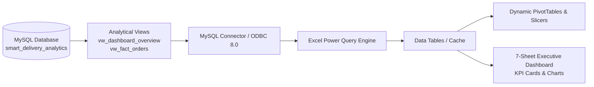

# MICROSOFT EXCEL & MYSQL INTEGRATION GUIDE

**Document ID:** DOC-EXC-007  
**Workbook:** `Smart_Delivery_Analytics.xlsx`  
**Database Target:** `smart_delivery_analytics` (MySQL 8.0+)  
**Technology:** Microsoft Excel (365 / 2021 / 2019) | Power Query | MySQL Connector/ODBC 8.0  
**Status:** Milestone 7 Operational Runbook  

---

## 1. Architectural Overview

The Microsoft Excel reporting layer provides dynamic spreadsheet analytics directly coupled to the validated MySQL database. The workbook maintains an end-to-end Single Source of Truth architecture:



---

## 2. Prerequisites & Driver Installation

To enable live data refresh from MySQL directly into Excel:

1. **Verify Excel Bit Architecture:**
   * Open Excel $\rightarrow$ Click **File** $\rightarrow$ **Account** $\rightarrow$ **About Excel**.
   * Note whether your installation is **64-bit** (recommended) or **32-bit**.
2. **Download & Install MySQL Connector/ODBC 8.0:**
   * Download the official MSI installer: [MySQL Connector/ODBC Downloads](https://dev.mysql.com/downloads/connector/odbc/).
   * Select **Windows (x86, 64-bit), MSI Installer** (must match your Excel bitness).
   * Complete standard installation.

---

## 3. Configuring the ODBC Data Source Name (DSN)

1. Open **ODBC Data Source Administrator (64-bit)** in Windows (type `odbcad32.exe` in Start/Run).
2. Navigate to the **System DSN** tab and click **Add...**
3. Select **MySQL ODBC 8.0 Unicode Driver** and click **Finish**.
4. Configure Connection Parameters:
   * **Data Source Name (DSN):** `SmartDeliveryAnalyticsDSN`
   * **Description:** Smart Delivery Operations Analytics MySQL Connection
   * **TCP/IP Server:** `localhost` (or `127.0.0.1`)
   * **Port:** `3306`
   * **User:** `root` (or your dedicated BI read-only user)
   * **Password:** `YourPassword`
   * **Database:** Select `smart_delivery_analytics` from the dropdown.
5. Click **Test** to confirm successful connection, then click **OK**.

---

## 4. Connecting Excel via Power Query (M Code)

### Method A: Connect Using Native ODBC DSN
1. In `Smart_Delivery_Analytics.xlsx`, go to the **Data** tab in the Excel ribbon.
2. Click **Get Data** $\rightarrow$ **From Other Sources** $\rightarrow$ **From ODBC**.
3. Select `SmartDeliveryAnalyticsDSN` from the DSN dropdown.
4. Expand `smart_delivery_analytics` in the Navigator pane and select:
   * `vw_dashboard_overview`
   * `vw_fact_orders`
   * `vw_city_performance`
   * `vw_monthly_revenue`
5. Click **Load To...** $\rightarrow$ Select **Table** and place in corresponding data sheet.

### Method B: Direct Power Query M Script
For advanced users, paste the following Power Query M code into the Advanced Editor:

```powerquery
let
    Source = Odbc.DataSource(
        "dsn=SmartDeliveryAnalyticsDSN", 
        [HierarchicalNavigation=true]
    ),
    Database = Source{[Name="smart_delivery_analytics", Kind="Database"]}[Data],
    vw_fact_orders_View = Database{[Name="vw_fact_orders", Kind="View"]}[Data]
in
    vw_fact_orders_View
```

---

## 5. Workbook Sheet Architecture & Functionality

The workbook [`Smart_Delivery_Analytics.xlsx`](file:///c:/sql_main/smart-delivery-analytics/07_excel/Smart_Delivery_Analytics.xlsx) is structured into 8 presentation sheets and 5 underlying data layers:

| Sheet Name | Content & Visuals | Key KPIs & Metrics Included | Excel Functions / Logic Used |
| :--- | :--- | :--- | :--- |
| **1. Executive Summary** | Headline Scorecard + City Table + Bar Chart | Total Orders (10,000), Customers (1,000), Net Revenue (₹6.41M), AOV (₹785), Cancel % (11.95%), Delivery Time (54.8m), Retention (65%), CSAT (2.99) | `COUNTA()`, `SUMIFS()`, `AVERAGEIFS()`, `COUNTIF()` linking dynamically to data tables |
| **2. Delivery Performance** | SLA Tiers + City Transit Table + Delay Chart + Speed Doughnut | Duration Tiers ($\le 30$m, 31-45m, 46-60m, $>60$m), City speed rankings, Delay % (>45m) | Segmented formulas, Bar chart, Doughnut chart |
| **3. Cancellation Analysis** | Weekday Patterns + 24-Hour Heatmap + Bar Chart | Day-of-week volume, cancellation %, hourly loss patterns, peak dinner surge drop-offs | Conditional formatting heatmap, column charts |
| **4. Revenue Analysis** | 24-Month Run-Rate + MoM Growth + Line Chart + Payment Yield | Monthly merchandise revenue, delivery fees, collected revenue, MoM growth rate %, payment channel yield | `LAG`-equivalent growth formulas, Multi-series Line chart |
| **5. Customer Analytics** | RFM Spend Tiers + Top 10 Customers + Pie Chart | Spend tiers (Low, Medium, High, VIP), Customer lifetime value, dormancy days, churn flags | Pie chart, Top customer ranking matrix |
| **6. Partner Performance** | Vehicle Modality Table + Fastest Couriers | Bike, Scooter, EV, Bicycle volume, average transit duration, top 10 fastest courier executives | Modality benchmarks, courier rankings |
| **7. Data Quality** | Census Scorecard & Audit Status | 7-table row census (29,300 records), null audit, orphan verification, cleaning sign-off | Formatted audit status table |
| **8. Refresh Instructions** | Standard Operating Procedure | Step-by-step refresh runbook for analysts and managers | Static reference guide |

---

## 6. How to Refresh Data

1. **One-Click Ribbon Refresh:**
   * Open the workbook in Microsoft Excel.
   * Press `Ctrl + Alt + F5` (or go to **Data** $\rightarrow$ **Refresh All**).
   * All background Power Query connections query MySQL, load latest orders, and update all dashboard KPI cards, tables, and charts instantly.
2. **Formula Integrity Guarantee:**
   * All KPI cards use dynamic formulas referencing data sheet ranges. They do not contain hardcoded constants, ensuring that when the database grows (e.g. from 10,000 to 15,000 orders), the entire dashboard recalculates automatically.

---

## 7. Troubleshooting Common Excel Connection Issues

| Symptom | Cause | Solution |
| :--- | :--- | :--- |
| `Architecture mismatch between Driver and Application` | Excel is 64-bit but 32-bit MySQL ODBC was installed (or vice versa). | Check Excel bitness (File $\rightarrow$ Account) and install the matching 64-bit or 32-bit MySQL ODBC driver. |
| `[HY000] [MySQL][ODBC 8.0(w) Driver]Can't connect to MySQL server on 'localhost'` | MySQL Server service is stopped or port 3306 is blocked. | Verify that MySQL Server 8.0 is running in Windows Services (`services.msc`). |
| `Formula returns #REF! or #VALUE!` | Data sheet row count expanded beyond initial range. | Formulas use broad column references (`Data_Orders!A2:A10001`); update reference bounds or use structured Excel Table names (`Table_Orders[OrderAmount]`). |
