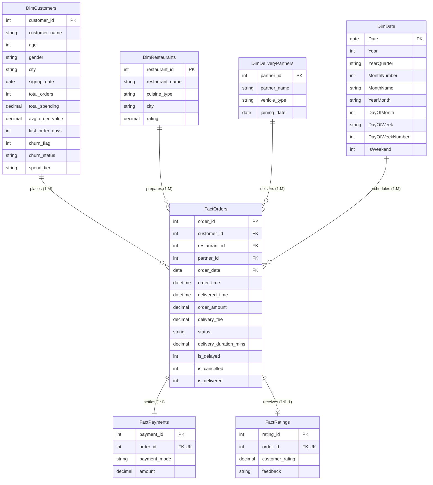

# POWER BI DATA MODEL ARCHITECTURE & STAR SCHEMA BLUEPRINT

**Document ID:** DOC-PBI-009  
**Model Name:** Smart Delivery Operations Analytics Dimensional Model  
**Target Solution:** Microsoft Power BI Desktop (`Smart_Delivery_Analytics.pbix`)  
**Design Pattern:** Kimbal-Style Dimensional Star Schema  
**Status:** Milestone 8 Production Architecture  

---

## 1. Architectural Philosophy: Star Schema vs Operational Schema

In enterprise business intelligence, importing raw relational 3NF operational tables directly into Power BI creates slow visual query response times, complex DAX formulas, and ambiguous relationship filter paths.

To achieve lightning-fast sub-second visual rendering and optimal VertiPaq in-memory columnar compression, the operational schema is transformed into a clean **Kimball-Style Star Schema**:



---

## 2. Table Catalog & Role Definitions

### 2.1 Fact Tables (Measurable Transaction Events)
1. **`FactOrders` (10,000 rows):** The central operational transaction ledger. Every order represents a single grain row containing the surrogate keys, timestamp, item amount, logistics fee, fulfillment status, and pre-calculated delivery duration in minutes.
2. **`FactPayments` (10,000 rows):** Financial checkout settlement sub-fact. Maintains a 1-to-1 relationship with `FactOrders`, recording payment mode and total settled amount.
3. **`FactRatings` (7,000 rows):** Post-delivery customer survey feedback sub-fact. Maintains a 1-to-0..1 relationship with `FactOrders` (delivered orders subset).

### 2.2 Dimension Tables (Filter Context & Slicers)
1. **`DimCustomers` (1,000 rows):** Consolidated customer dimension uniting demographic attributes from `customers` with behavioral RFM indicators from `customer_behavior`.
2. **`DimRestaurants` (100 rows):** Merchant catalog containing establishment name, gastronomic cuisine category, kitchen hub city, and platform rating.
3. **`DimDeliveryPartners` (200 rows):** Courier fleet dimension storing courier name, transportation vehicle modality, and onboarding date.
4. **`DimDate` (731 rows):** Dedicated calendar dimension covering two full calendar years (2023-01-01 through 2024-12-31) enabling seamless time-intelligence calculations without date gaps.

---

## 3. Relationship Matrix & Cardinality Rules

| From Table (Dimension) | From Column (PK) | To Table (Fact) | To Column (FK) | Cardinality | Filter Direction | Active |
| :--- | :--- | :--- | :--- | :---: | :---: | :---: |
| `DimDate` | `Date` | `FactOrders` | `order_date` | **1 : Many (1 : \*)** | Single (Dim $\rightarrow$ Fact) | **Yes** |
| `DimCustomers` | `customer_id` | `FactOrders` | `customer_id` | **1 : Many (1 : \*)** | Single (Dim $\rightarrow$ Fact) | **Yes** |
| `DimRestaurants` | `restaurant_id` | `FactOrders` | `restaurant_id` | **1 : Many (1 : \*)** | Single (Dim $\rightarrow$ Fact) | **Yes** |
| `DimDeliveryPartners` | `partner_id` | `FactOrders` | `partner_id` | **1 : Many (1 : \*)** | Single (Dim $\rightarrow$ Fact) | **Yes** |
| `FactOrders` | `order_id` | `FactPayments` | `order_id` | **1 : 1** | Both (Bi-directional) | **Yes** |
| `FactOrders` | `order_id` | `FactRatings` | `order_id` | **1 : 0..1** | Both (Bi-directional) | **Yes** |

> [!IMPORTANT]
> **Single-Direction Filter Rule:** All dimension-to-fact relationships enforce **Single (One-Way) filter direction**. Filters applied to Customers, Restaurants, Couriers, or Dates flow downward into `FactOrders`, preventing circular filter dependency and performance degradation.

---

## 4. Dedicated `DimDate` Calendar Dimension (DAX Definition)

To enable robust time intelligence (`TOTALYTD`, `DATEADD`, `SAMEPERIODLASTYEAR`), a dedicated Date table is generated via DAX:

```dax
DimDate = 
VAR MinDate = DATE(2023, 1, 1)
VAR MaxDate = DATE(2024, 12, 31)
RETURN
    ADDCOLUMNS(
        CALENDAR(MinDate, MaxDate),
        "Year", YEAR([Date]),
        "YearQuarter", CONCATENATE(YEAR([Date]), "-Q" & FORMAT([Date], "Q")),
        "Quarter", "Q" & FORMAT([Date], "Q"),
        "MonthNumber", MONTH([Date]),
        "MonthName", FORMAT([Date], "MMMM"),
        "MonthShort", FORMAT([Date], "MMM"),
        "YearMonth", FORMAT([Date], "YYYY-MM"),
        "DayOfMonth", DAY([Date]),
        "DayOfWeek", FORMAT([Date], "dddd"),
        "DayOfWeekShort", FORMAT([Date], "ddd"),
        "DayOfWeekNumber", WEEKDAY([Date], 2), -- 1 = Monday, 7 = Sunday
        "IsWeekend", IF(WEEKDAY([Date], 2) IN {6, 7}, 1, 0)
    )
```

**Sort-by-Column Configuration:**
* Set `MonthName` $\rightarrow$ Sort by `MonthNumber`.
* Set `MonthShort` $\rightarrow$ Sort by `MonthNumber`.
* Set `YearMonth` $\rightarrow$ Sort by `Date`.
* Set `DayOfWeek` $\rightarrow$ Sort by `DayOfWeekNumber`.
* Mark as Date Table: Set `DimDate[Date]` as the primary date column.
