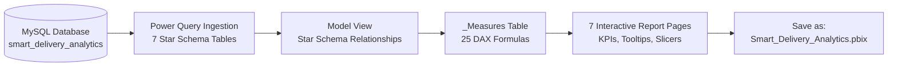

# MICROSOFT POWER BI DESKTOP BUILD & INTEGRATION GUIDE

**Document ID:** DOC-PBI-010  
**Project:** Smart Delivery Operations Analytics System  
**Target File to Generate:** `Smart_Delivery_Analytics.pbix`  
**Data Source:** MySQL 8.0+ Database `smart_delivery_analytics`  
**Author:** Senior Business Intelligence & Power BI Developer  
**Status:** Milestone 8 Production Runbook  

---

## 1. Overview & Operating Strategy

This guide provides the complete, authoritative step-by-step operating instructions to build, configure, format, and save the native Power BI project:

```
c:\sql_main\smart-delivery-analytics\08_power_bi\Smart_Delivery_Analytics.pbix
```

In accordance with enterprise governance rules, this runbook provides the exact Power Query M code, Star Schema relationships, DAX measure assignments, and visual page layout specifications across all **seven required dashboards**.



---

## 2. Prerequisites & Driver Installation

1. **Install Microsoft Power BI Desktop:**
   * Download the free 64-bit installer from the Microsoft Store or [Microsoft Power BI Desktop Download](https://powerbi.microsoft.com/desktop/).
2. **Install Oracle MySQL Connector / NET (or MySQL ODBC 8.0):**
   * Download and install **MySQL Connector/NET 8.0.33+ (64-bit)**: [Connector/NET Download](https://dev.mysql.com/downloads/connector/net/).
   * This enables Power BI's native `MySQL.Database()` connector.
   * Alternatively, use the **MySQL ODBC 8.0 Unicode Driver** configured in Milestone 7.

---

## 3. Power Query Ingestion & Star Schema Construction

1. Launch **Power BI Desktop**.
2. Click **Get Data** $\rightarrow$ **MySQL database** (or **ODBC**).
3. In the Connection Dialog:
   * **Server:** `localhost` (or `127.0.0.1:3306`)
   * **Database:** `smart_delivery_analytics`
   * **Data Connectivity Mode:** Select **Import** (enables full in-memory DAX functionality).
4. Enter credentials (`root` and password).
5. In the **Navigator** window, select the following 6 core tables:
   * `orders` $\rightarrow$ Rename query to `FactOrders`
   * `payments` $\rightarrow$ Rename query to `FactPayments`
   * `ratings` $\rightarrow$ Rename query to `FactRatings`
   * `customers` $\rightarrow$ Rename query to `DimCustomers`
   * `restaurants` $\rightarrow$ Rename query to `DimRestaurants`
   * `delivery_partners` $\rightarrow$ Rename query to `DimDeliveryPartners`
6. Click **Transform Data** to open the **Power Query Editor**.

### Power Query M Transformations:
* **In `FactOrders`:**
  - Add Custom Column: `order_date = DateTime.Date([order_time])` (Type: Date).
  - Add Custom Column:
    ```powerquery
    delivery_duration_mins = if [status] = "Delivered" and [delivered_time] <> null 
    then Duration.TotalMinutes([delivered_time] - [order_time]) 
    else null
    ```
    (Type: Decimal Number).
  - Add Custom Column: `is_delayed = if [delivery_duration_mins] > 45 then 1 else 0` (Type: Int64).
  - Set column types: `order_amount` (Fixed Decimal / Currency), `delivery_fee` (Fixed Decimal / Currency).
* **In `DimCustomers`:**
  - Merge queries with `customer_behavior` on `customer_id` $\rightarrow$ Expand columns: `total_orders`, `total_spending`, `avg_order_value`, `last_order_days`, `churn_flag`.
  - Add Conditional Column: `churn_status = if [churn_flag] = 1 then "Churned" else "Active"`.
  - Add Conditional Column:
    ```powerquery
    spend_tier = if [total_spending] < 4000 then "1. Low (< ₹4K)"
    else if [total_spending] <= 7000 then "2. Medium (₹4K-₹7K)"
    else if [total_spending] <= 10000 then "3. High (₹7K-₹10K)"
    else "4. VIP (> ₹10K)"
    ```
* Click **Close & Apply** to load the data into the data model.

---

## 4. Building the `DimDate` Calendar Table

In Power BI Desktop, click **Modeling** $\rightarrow$ **New Table** and paste:

```dax
DimDate = 
VAR MinDate = DATE(2023, 1, 1)
VAR MaxDate = DATE(2024, 12, 31)
RETURN
    ADDCOLUMNS(
        CALENDAR(MinDate, MaxDate),
        "Year", YEAR([Date]),
        "YearQuarter", CONCATENATE(YEAR([Date]), "-Q" & FORMAT([Date], "Q")),
        "Quarter", "Q" & FORMAT([Date], "Q"),
        "MonthNumber", MONTH([Date]),
        "MonthName", FORMAT([Date], "MMMM"),
        "MonthShort", FORMAT([Date], "MMM"),
        "YearMonth", FORMAT([Date], "YYYY-MM"),
        "DayOfMonth", DAY([Date]),
        "DayOfWeek", FORMAT([Date], "dddd"),
        "DayOfWeekShort", FORMAT([Date], "ddd"),
        "DayOfWeekNumber", WEEKDAY([Date], 2),
        "IsWeekend", IF(WEEKDAY([Date], 2) IN {6, 7}, 1, 0)
    )
```

Mark `DimDate` as a Date Table (Right-click `DimDate` $\rightarrow$ **Mark as date table** $\rightarrow$ select `Date`).

---

## 5. Establishing Star Schema Relationships (Model View)

Switch to the **Model View** (left pane) and drag-and-drop to establish the following relationships:

1. `DimDate[Date]` $(1) \longrightarrow (\ast)$ `FactOrders[order_date]` (Single direction)
2. `DimCustomers[customer_id]` $(1) \longrightarrow (\ast)$ `FactOrders[customer_id]` (Single direction)
3. `DimRestaurants[restaurant_id]` $(1) \longrightarrow (\ast)$ `FactOrders[restaurant_id]` (Single direction)
4. `DimDeliveryPartners[partner_id]` $(1) \longrightarrow (\ast)$ `FactOrders[partner_id]` (Single direction)
5. `FactOrders[order_id]` $(1) \longrightarrow (1)$ `FactPayments[order_id]` (Both directions)
6. `FactOrders[order_id]` $(1) \longrightarrow (0..1)$ `FactRatings[order_id]` (Both directions)

---

## 6. Creating the Dedicated `_Measures` Table & DAX Library

1. In the **Home** tab, click **Enter Data** $\rightarrow$ Name the table `_Measures` $\rightarrow$ Click **Load**.
2. Right-click `_Measures` $\rightarrow$ Select **New Measure**.
3. Create all 25 measures documented in [`dax_measures.md`](file:///c:/sql_main/smart-delivery-analytics/08_power_bi/dax_measures.md), including:
   * `[Total Orders]`, `[Delivered Orders]`, `[Cancelled Orders]`
   * `[Delivered Merchandise Revenue]`, `[Total Delivery Fees]`, `[Total Realized Revenue]`
   * `[Average Order Value]`, `[Cancelled Lost Revenue]`
   * `[Previous Month Delivered Revenue]`, `[Month-over-Month Growth %]`, `[Cumulative YTD Revenue]`
   * `[Average Delivery Time (Mins)]`, `[Delayed Orders Count]`, `[SLA Breach Rate %]`, `[On-Time Delivery %]`
   * `[Order Cancellation Rate %]`, `[Customer Retention Rate %]`, `[Average Customer Rating]`
   * `[Partner Delivery Speed Rank]`, `[Partner Volume Rank]`
4. Set explicit number and currency formatting for each measure.

---

## 7. Report Page Visual Specifications (7 Dashboards)

### Page 1: Executive Overview
* **Canvas Settings:** 16:9 widescreen ($1280 \times 720$), Dark theme background (`#0F172A`).
* **Header:** "Smart Delivery Operations — Executive Command Center" (`#38BDF8`).
* **Slicers (Top Ribbon):** Date Range Slider (`DimDate[Date]`), City Dropdown (`DimRestaurants[city]`).
* **Row 1 (KPI Cards):**
  - Card 1: `[Total Orders]` (10,000)
  - Card 2: `[Total Customers]` (1,000)
  - Card 3: `[Total Realized Revenue]` (₹6.70M)
  - Card 4: `[Average Order Value]` (₹785.02)
  - Card 5: `[Order Cancellation Rate %]` (11.95%)
  - Card 6: `[Average Delivery Time (Mins)]` (54.8 mins)
  - Card 7: `[Customer Retention Rate %]` (65.0%)
  - Card 8: `[Average Customer Rating]` (2.99 / 5.0)
* **Visual 1 (Area / Line Chart):** `DimDate[YearMonth]` on X-axis, `[Total Realized Revenue]` on Y-axis.
* **Visual 2 (Clustered Bar Chart):** `DimRestaurants[city]` on Y-axis, `[Total Realized Revenue]` on X-axis.
* **Visual 3 (Donut Chart):** `FactOrders[status]` in Legend, `[Total Orders]` in Values.

### Page 2: Delivery Operations
* **Row 1 (KPI Cards):** `[Average Delivery Time (Mins)]`, `[Delayed Orders Count]`, `[SLA Breach Rate %]`, `[On-Time Delivery %]`.
* **Visual 1 (Line Chart):** `DimDate[YearMonth]` vs `[Average Delivery Time (Mins)]` with a reference constant line at 45 mins.
* **Visual 2 (Bar Chart):** `DimRestaurants[city]` vs `[SLA Breach Rate %]`.
* **Visual 3 (Table / Matrix):** Top 10 Slowest Restaurants: `DimRestaurants[restaurant_name]`, `city`, `cuisine_type`, `[Delivered Orders]`, `[Average Delivery Time (Mins)]`.
* **Visual 4 (Clustered Column Chart):** `DimDeliveryPartners[vehicle_type]` vs `[Average Delivery Time (Mins)]`.

### Page 3: Cancellation Analysis
* **Row 1 (KPI Cards):** `[Cancelled Orders]`, `[Order Cancellation Rate %]`, `[Cancelled Lost Revenue]`.
* **Visual 1 (Bar Chart):** `DimRestaurants[city]` vs `[Order Cancellation Rate %]`.
* **Visual 2 (Column Chart):** `DimRestaurants[cuisine_type]` vs `[Cancelled Lost Revenue]`.
* **Visual 3 (Matrix Heatmap):** Rows: `DimDate[DayOfWeek]`, Columns: `Hour (FactOrders[order_time])`, Values: `[Order Cancellation Rate %]` (Conditional formatting color scale: White to Deep Red).

### Page 4: Revenue Analytics
* **Row 1 (KPI Cards):** `[Delivered Merchandise Revenue]`, `[Total Delivery Fees]`, `[Total Realized Revenue]`, `[Month-over-Month Growth %]`.
* **Visual 1 (Combo Line & Column Chart):** X-axis: `DimDate[YearMonth]`, Column Y-axis: `[Total Realized Revenue]`, Line Y-axis: `[Month-over-Month Growth %]`.
* **Visual 2 (Donut Chart):** `FactPayments[payment_mode]` vs `[Total Realized Revenue]`.
* **Visual 3 (Table):** Merchant Revenue Rankings: `DimRestaurants[restaurant_name]`, `city`, `cuisine_type`, `[Delivered Orders]`, `[Total Realized Revenue]`, `[Average Order Value]`.

### Page 5: Customer Analytics
* **Row 1 (KPI Cards):** `[Total Customers]`, `[Active Customers]`, `[Churned Customers]`, `[Customer Retention Rate %]`.
* **Visual 1 (Donut Chart):** `DimCustomers[churn_status]` vs `[Total Customers]`.
* **Visual 2 (Clustered Bar Chart):** `DimCustomers[spend_tier]` vs `[Total Realized Revenue]`.
* **Visual 3 (Table):** Top 10 Customers by LTV: `DimCustomers[customer_name]`, `city`, `[Delivered Orders]`, `total_spending`, `last_order_days`, `churn_status`.
* **Visual 4 (Line Chart):** Customer Acquisition Cohort Retention by `signup_date` quarter.

### Page 6: Partner Analytics
* **Row 1 (KPI Cards):** Active Couriers (200), `[Average Delivery Time (Mins)]`, `[Average Customer Rating]`.
* **Visual 1 (Scatter Chart):** X-axis: `[Average Delivery Time (Mins)]`, Y-axis: `[Average Customer Rating]`, Details: `DimDeliveryPartners[partner_name]`, Size: `[Delivered Orders]`.
* **Visual 2 (Table):** Courier Leaderboard: `DimDeliveryPartners[partner_name]`, `vehicle_type`, `[Delivered Orders]`, `[Average Delivery Time (Mins)]`, `[Average Customer Rating]`, `[Partner Delivery Speed Rank]`.

### Page 7: Data Quality
* **Row 1 (KPI Cards):** Source Records (29,300), Loaded Records (29,300), Duplicate Records (0), Orphan Keys (0).
* **Visual 1 (Table):** Census Audit Scorecard comparing Documented vs Loaded records for all 7 tables with "PASS" status indicators.
* **Visual 2 (Card):** Operational Health Certification Banner: "Certified Clean 3NF Core — Zero Orphans | 100% Financial Reconciliation".

---

## 8. Finalizing & Saving `Smart_Delivery_Analytics.pbix`

1. Go to **File** $\rightarrow$ **Save As...**
2. Browse to:
   ```
   c:\sql_main\smart-delivery-analytics\08_power_bi\
   ```
3. Set File Name to: `Smart_Delivery_Analytics.pbix`.
4. Click **Save**.
