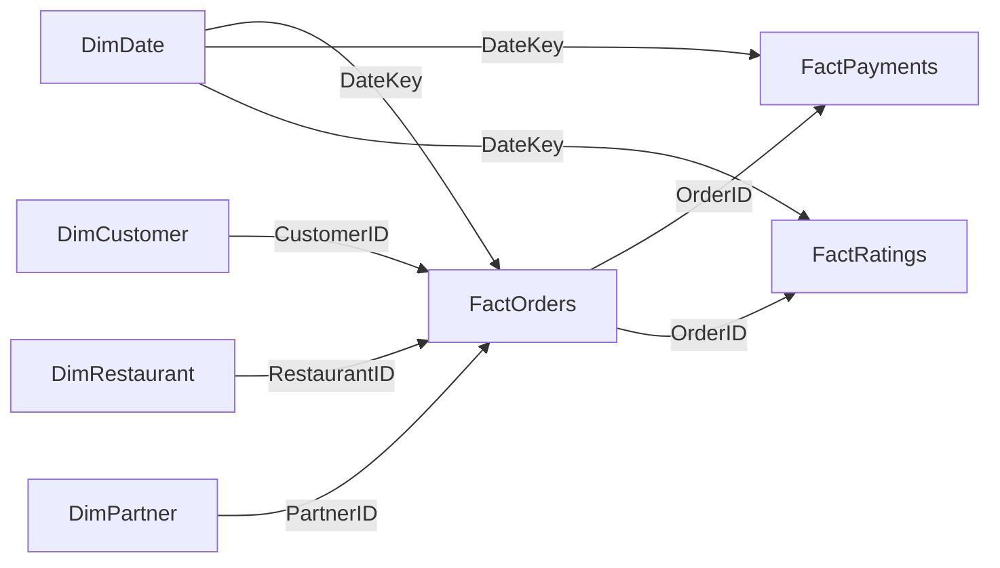

# Power BI Data Model – Smart Delivery Analytics

## Overview
The model follows a classic **star schema** to keep Power BI performant and to ensure that all business‑logic calculations stay consistent with the MySQL analytical layer.

### Fact Tables (Transactional)
| Table | Description | Key Columns |
|-------|-------------|--------------|
| **FactOrders** | Each order with derived delivery duration and revenue metrics. | `OrderID` (PK), `CustomerID`, `RestaurantID`, `PartnerID`, `DateKey`, `OrderAmount`, `DeliveryFee`, `DeliveryDurationMins`, `Status` |
| **FactPayments** | Normalised payment rows linked to orders. | `PaymentID` (PK), `OrderID`, `DateKey`, `Amount`, `PaymentMode` |
| **FactRatings** | Customer feedback per order. | `RatingID` (PK), `OrderID`, `DateKey`, `CustomerRating`, `Feedback` |

### Dimension Tables (Reference)
| Table | Description | Key Columns |
|-------|-------------|--------------|
| **DimCustomer** | Customer master data and behavioural aggregates. | `CustomerID` (PK), `CustomerName`, `Age`, `Gender`, `City`, `SignupDate`, `TotalOrders`, `TotalSpending`, `AvgOrderValue`, `LastOrderDays`, `ChurnFlag` |
| **DimRestaurant** | Restaurant master data. | `RestaurantID` (PK), `RestaurantName`, `CuisineType`, `City`, `Rating` |
| **DimPartner** | Delivery‑partner master data. | `PartnerID` (PK), `PartnerName`, `VehicleType`, `JoiningDate` |
| **DimDate** | Calendar dimension (Date, Year, Quarter, Month, Week, Day‑of‑Week). | `DateKey` (PK, format YYYYMMDD), `Date`, `Year`, `Quarter`, `Month`, `MonthName`, `WeekOfYear`, `DayOfWeek`, `IsWeekend`, `IsHoliday` |

## Relationships

* All relationships are **one‑to‑many** (dimension → fact) and enforce **referential integrity**.
* Cardinality is set to **single** on the dimension side and **multiple** on the fact side.
* Use **inner joins** by default – Power BI will filter out any orphaned rows.

## Why This Design?
* **Performance** – Star schema enables Power BI’s VertiPaq engine to compress dimension tables heavily.
* **Consistency** – All calculated columns (e.g., `DeliveryDurationMins`) are pre‑computed in the MySQL view `vw_fact_orders` and imported as a column, guaranteeing the same numbers across Excel and Power BI.
* **Scalability** – Adding new facts (e.g., promotional events) only requires a new fact table without touching existing dimensions.

---

*All table and column names match the MySQL analytical layer exactly (case‑insensitive) so that the same SQL scripts can be reused for data validation.*
