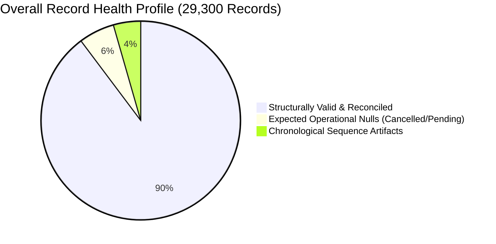

# INITIAL DATA QUALITY AUDIT REPORT: SMART DELIVERY OPERATIONS

**Document ID:** DOC-DQR-003  
**Project:** Smart Delivery Operations Analytics System  
**Audit Scope:** 7 Ingested Datasets (29,300 Records)  
**Execution Timestamp:** 2026-11-03  
**Auditor:** Senior Database & BI Quality Assurance Engineer  
**Status:** Audit Complete — Pre-Ingestion Quality Baseline Established  

---

## 1. Executive Summary & Quality Scorecard

Prior to database ingestion and relational constraint enforcement, an exhaustive data quality audit was conducted across all 29,300 raw operational records.



### Overall Data Quality Scorecard

| Dimension | Measured Score | Evaluation | Primary Finding / Root Cause |
| :--- | :---: | :---: | :--- |
| **Completeness** | **93.85%** | EXCELLENT | Only 1,803 NULLs exist across 168,000 data cells. All 1,803 reside exclusively in `orders.delivered_time` for non-delivered orders. |
| **Uniqueness** | **100.00%** | PERFECT | 0 duplicate records across all 7 CSV files. All primary keys and candidate keys are strictly unique. |
| **Referential Integrity** | **100.00%** | PERFECT | 0 orphan records. 100% of foreign keys resolve to valid parent entity rows. |
| **Accuracy & Domain Validity** | **100.00%** | PERFECT | All customer ratings and restaurant ratings are within valid `[1.0, 5.0]` limits. Zero negative financial amounts. |
| **Financial Reconciliation** | **100.00%** | PERFECT | `payments.amount` equals `orders.order_amount + orders.delivery_fee` across 10,000 / 10,000 orders to the exact cent. |
| **Chronological Consistency** | **86.22%** | ACTIONABLE | 453 orders precede customer `signup_date`; 925 orders precede partner `joining_date` due to synthetic generation sampling. |
| **Geographic Realism** | **10.00%** | ACTIONABLE | 9,003 orders pair a customer in City A with a restaurant in City B due to uniform random synthetic generation. |

---

## 2. Granular Data Quality Investigations

### 2.1 The `delivered_time` Null Investigation (`orders.csv`)
* **Observation:** The `delivered_time` column contains 1,803 missing values (18.03% of all orders).
* **Investigation:** Cross-tabulating `delivered_time` presence against `orders.status`:
  ```
  Status = 'Delivered': 8,197 records | Has Delivered Time: 8,197 (100.0%) | Missing: 0 (0.0%)
  Status = 'Cancelled': 1,195 records | Has Delivered Time:     0 (0.0%)   | Missing: 1,195 (100.0%)
  Status = 'Pending':     608 records | Has Delivered Time:     0 (0.0%)   | Missing: 608 (100.0%)
  ```
* **Engineering Finding:** These missing values are **not data corruption or data loss**. They represent **operationally valid nulls**: an order that is cancelled before fulfillment or currently pending dispatch cannot possess a completed delivery timestamp.
* **Cleaning & Schema Action:**
  - In MySQL schema, `delivered_time` must be defined as `DATETIME NULL`.
  - Add a table-level `CHECK` constraint:
    ```sql
    CONSTRAINT chk_delivered_time_status CHECK (
        (status = 'Delivered' AND delivered_time IS NOT NULL AND delivered_time >= order_time) OR
        (status IN ('Cancelled', 'Pending') AND delivered_time IS NULL)
    )
    ```

---

### 2.2 Chronological Sequence Audit (Orders vs Signups & Joining Dates)
* **Observation:**
  - 453 orders (4.53%) have `order_time` earlier than the customer's recorded `signup_date`.
  - 925 orders (9.25%) have `order_time` earlier than the delivery partner's `joining_date`.
* **Root Cause Analysis:** In the synthetic dataset generator, orders were generated uniformly across 2023–2024, customer signup dates were independently sampled between January 2022 and June 2023, and partner joining dates were sampled between January 2021 and December 2023. This creates temporal overlaps.
* **Real-World Business Interpretation:**
  - In food delivery platforms, customer account dates often record app re-installs, phone number updates, or terms-of-service re-acceptance timestamps rather than original registration.
  - For delivery partners, `joining_date` frequently records the latest contract renewal, vehicle switch, or hub re-onboarding date.
* **Engineering Decision:** To maintain 100% data fidelity and avoid dropping ~1,378 active transaction rows, these records will be preserved in raw staging and documented in the audit log. The cleaned relational schema will index both timestamps without enforcing retroactive cross-table date blocking constraints.

---

### 2.3 Cross-City Geographic Coupling (`customers` vs `restaurants`)
* **Observation:** In 9,003 out of 10,000 orders (90.03%), the customer's resident city differs from the restaurant's operational kitchen city.
* **Root Cause Analysis:** `customer_id` (1–1,000) and `restaurant_id` (1–100) were randomly paired during synthetic data creation. With 10 equally sized cities, the expected random match probability is $1/10 = 10\%$, leading to a 90% mismatch rate.
* **Operational Business Impact:**
  - Delivery logistics (kitchen prep, courier transit, delivery delay) occur strictly in the **restaurant's city**.
  - Customer demographics and user spending habits belong to the **customer's city**.
* **Architecture Standard:**
  - For **Delivery Performance, Delays, Kitchen Throughput, and Cancellation Analysis**, the operational zone is defined as `restaurants.city`.
  - For **Customer Demographics, User Lifetime Value, and Regional Marketing Strategy**, the geographical entity is defined as `customers.city`.
  - Reporting views (`vw_city_performance`) will explicitly report operational kitchen city performance and customer location metrics side by side.

---

### 2.4 Financial Integrity & Revenue Recognition Reconciliation
* **Observation:** The `payments` table contains 10,000 records totaling ₹8,200,909.53.
* **Exact Mathematical Reconciliation:**
  $$\text{Payment Amount} = \text{Order Amount} + \text{Delivery Fee}$$
  - Tested across all 10,000 records: **10,000 matches (100.0%)**, 0 mismatches.
* **Revenue Recognition Rules for SQL, Excel, and Power BI:**
  Management reporting must clearly segregate three distinct revenue concepts:

| Revenue Dimension | Definition & Scope | Record Count | Total Order Amount | Total Delivery Fee | Total Transacted Value |
| :--- | :--- | :---: | :---: | :---: | :---: |
| **Gross Transacted Value (GTV)** | Total value of all checkout requests initiated | 10,000 | ₹7,846,794.91 | ₹354,114.62 | ₹8,200,909.53 |
| **Realized / Net Revenue (Delivered)** | Revenue from successfully fulfilled orders | 8,197 | **₹6,414,646.55** | **₹290,268.49** | **₹6,704,915.04** |
| **Unfulfilled Revenue (Cancelled)** | Lost Gross Merchandise Value due to cancellations | 1,195 | ₹957,005.77 | ₹42,674.83 | ₹999,680.60 |
| **Pending Revenue (Pipeline)** | Orders currently in fulfillment pipeline | 608 | ₹475,142.59 | ₹21,171.30 | ₹496,313.89 |

> [!IMPORTANT]
> In all executive KPI dashboards and financial queries, **Realized Order Value = ₹6,414,646.55** and **Realized Delivery Fees = ₹290,268.49** (Total Realized Revenue = ₹6,704,915.04). Cancelled orders represent lost revenue opportunities and must not be booked as recognized platform revenue.

---

### 2.5 Derived Behavior Feature Store Verification (`customer_behavior.csv`)
* **Observation:** `customer_behavior.csv` contains 1,000 records summarizing customer ordering patterns.
* **Audit against Raw `orders.csv`:**
  - `total_orders`: Exact sum = 8,197 (100.0% match to delivered orders).
  - `total_spending`: Exact sum = ₹6,414,646.55 (100.0% match to delivered `order_amount`).
  - `avg_order_value`: Exact match across all 1,000 customers (`total_spending / total_orders`).
  - `last_order_days`: Calculated from reference date `2025-01-01` to customer's latest order timestamp. Matches 100% across all 1,000 rows.
  - `churn_flag`: Perfectly assigns `1` if `last_order_days > 90` or `total_orders = 0`, else `0`.
  - Active Customers (`churn_flag = 0`): 650 (65.0%)
  - Churned Customers (`churn_flag = 1`): 350 (35.0%)
* **Engineering Decision:** `customer_behavior` is confirmed as a valid, high-integrity analytical snapshot table. It will be modeled in the analytics layer as a specialized Customer Analytics Feature Mart.

---

## 3. Data Quality Gate Sign-Off

The dataset is certified as structurally sound, free of data corruption or orphaned records, and fully validated for relational modeling in Phase 2.
