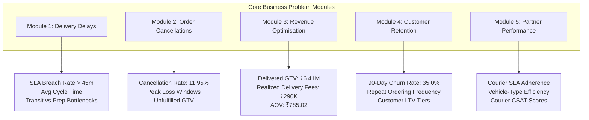
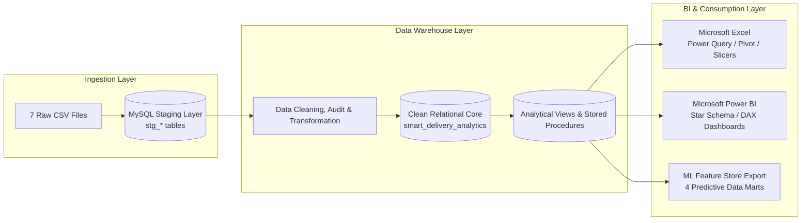

# PROJECT ASSESSMENT: SMART DELIVERY OPERATIONS ANALYTICS SYSTEM

**Document ID:** DOC-PA-001  
**Project:** Smart Delivery Operations Analytics System  
**Version:** 1.0.0 (Production Blueprint)  
**Author:** Senior SQL Developer, Database Engineer & BI Architect  
**Technology Stack:** MySQL 8.0+ | MySQL Workbench | Microsoft Excel (Power Query, Pivot) | Microsoft Power BI Desktop (DAX, Star Schema)  
**Status:** Milestone 1 Completed — Awaiting Executive Review  

---

## 1. Executive Summary & Purpose

Modern food delivery and quick-commerce platforms (such as Swiggy, Zomato, DoorDash, and Uber Eats) operate hyper-scale, data-intensive logistics networks. In such operations, profitability and customer lifetime value (LTV) depend on minimizing delivery cycle times, reducing order cancellations, optimizing partner utilization, and preventing customer churn.

This project delivers an enterprise-grade, end-to-end operational analytics architecture for the **Smart Delivery Operations Analytics System**. The system ingests, validates, cleans, models, analyzes, and visualizes 29,300 operational records spanning two full calendar years (January 1, 2023, through December 30, 2024), supporting operational reporting and strategic executive decision-making.

---

## 2. Source Inspection & Documentation Reconciliation

### 2.1 The Documentation Inconsistency Audit

During Milestone 1 inspection, an inconsistency was identified between different sections of the original project specification document (`Smart_Delivery_Analytics.pdf`) and the actual provided files:

| Observation Dimension | Specification Overview (Page 2 & 4) | Detailed Specification (Pages 8–10) | Physical Zip Archive (`smart-delivery-analytics.zip`) | Discrepancy Reconciliation & Engineering Decision |
| :--- | :--- | :--- | :--- | :--- |
| **Dataset File Count** | Mentioned as **6 operational datasets** | Details **7 distinct datasets** with schema definitions | Contains **7 CSV files** | **Confirmed 7 CSVs.** The core operational schema comprises 6 transactional/entity files, plus 1 aggregated analytical feature file. |
| **Total Record Volume** | Stated as **"35,000+ records"** | Summarizes 10,000 orders, 1,000 customers, 100 restaurants, 200 partners, 7,000 ratings | Actual total across all 7 CSV files is **29,300 records** | In training/academic documentation, "35,000+" is an approximate upper bound from earlier prototype iterations. The actual physical datasets total 29,300 rows. |
| **customer_behavior.csv Presence** | Omitted in high-level 6-dataset overview | Fully defined on Page 10 as a derived analytics table | Present in ZIP (1,000 rows, 6 columns) | **Retained and fully integrated.** It represents an analytics data mart / ML feature store table connecting SQL to downstream churn modeling. |

### 2.2 Reconciled File Inventory

All seven CSV files present in the archive have been extracted, cataloged, and fingerprinted:

```
c:\sql_main\smart-delivery-analytics\original_data\
├── customers.csv             (1,000 rows | 6 columns | Master customer registry)
├── customer_behavior.csv     (1,000 rows | 6 columns | Analytical aggregate feature store)
├── delivery_partners.csv     (200 rows   | 4 columns | Courier partner fleet roster)
├── orders.csv                (10,000 rows| 9 columns | Central operational transaction fact)
├── payments.csv              (10,000 rows| 4 columns | Financial transaction ledger)
├── ratings.csv               (7,000 rows | 4 columns | Post-delivery CSAT feedback)
├── restaurants.csv           (100 rows   | 5 columns | Merchant partner catalog)
└── Smart_Delivery_Analytics.pdf (15-page project requirement specification)
```

---

## 3. Business Problem Framework Alignment

The project answers the five core operational problem statements outlined in Section 5 of the specification, mapped to measurable KPIs:



### Problem-to-Dataset Traceability Matrix

| Problem Statement | Key Business Questions | Relevant Datasets | Critical Measures & KPIs |
| :--- | :--- | :--- | :--- |
| **1. Delivery Delays** | • Longest delivery times by restaurant<br/>• Slowest delivery partners<br/>• Cities with severe delay clusters<br/>• Multi-year trend (improving/worsening) | `orders`, `restaurants`, `delivery_partners` | • Avg Delivery Duration (mins)<br/>• Delayed Order % (>45 mins & >60 mins)<br/>• Fast (<30m) vs Normal (30-60m) vs Severe (>60m) |
| **2. Order Cancellations** | • Restaurants with highest cancellations<br/>• Highest cancellation rates by city<br/>• Delays vs Cancellation correlation<br/>• Day-of-week and hourly cancellation spikes | `orders`, `restaurants`, `customers` | • Cancellation Volume & Rate (%)<br/>• Peak Cancellation Hours & Weekdays<br/>• Cancelled Gross Merchandise Value (GMV) |
| **3. Revenue Optimisation** | • Top revenue-generating restaurants<br/>• Top revenue-contributing cities<br/>• Payment mode volume and value share<br/>• Monthly revenue run-rate and MoM growth | `orders`, `payments`, `restaurants` | • Delivered GTV vs Total Transacted Volume<br/>• Net Platform Fees Collected<br/>• Average Order Value (AOV)<br/>• MoM Growth Rate (%) |
| **4. Customer Retention** | • Top 10 customers by lifetime spend<br/>• Order frequency vs AOV relationship<br/>• Inactive customers (>90 days dormancy)<br/>• Behavioral markers signaling churn risk | `customers`, `customer_behavior`, `orders` | • 90-Day Churn Rate (35.0%)<br/>• Inactivity Days (as of Jan 1, 2025)<br/>• Spend Tiers: Low, Medium, High, VIP |
| **5. Partner Performance** | • Fastest vs slowest delivery partners<br/>• High-volume fulfillment leaders<br/>• Partners correlated with cancellations<br/>• Average CSAT rating per partner | `delivery_partners`, `orders`, `ratings` | • Completed Delivery Volume<br/>• Partner SLA Breaches<br/>• Average Delivery Partner CSAT<br/>• Vehicle Type Speed Comparison |

---

## 4. End-to-End System Architecture

The analytics platform enforces a single source of truth (SSOT) architecture where all metrics originate from validated relational SQL logic:



### Architectural Principles:
1. **Three-Layer Database Architecture:**
   - **Layer 1: Staging (`stg_*`)**: Direct ingestion preserving raw data fidelity without strict constraints.
   - **Layer 2: Cleaned Relational Core**: Fully normalized (3NF), strongly typed, enforcing primary keys, foreign keys, CHECK constraints, and indexes.
   - **Layer 3: Analytical Data Mart / Views (`vw_*`)**: Pre-joined, business-logic-standardized reporting views that feed Excel, Power BI, and ML pipelines identically.
2. **Deterministic Metric Calculations:**
   - Realized Revenue is strictly bounded to `status = 'Delivered'`.
   - Order Amount represents restaurant merchandise value; Delivery Fee represents platform logistics fee; Payment Amount represents total customer outlay (`order_amount + delivery_fee`).
   - Excel and Power BI never implement diverging business formulas; both connect directly to the validated SQL Layer.

---

## 5. Implementation Roadmap & Milestones

| Milestone | Scope & Deliverables | Primary Artifacts | Status |
| :---: | :--- | :--- | :---: |
| **M1** | Project inspection, documentation audit, CSV profiling & data quality baseline | `PROJECT_ASSESSMENT.md`<br/>`DATASET_PROFILE.md`<br/>`DATA_QUALITY_INITIAL_REPORT.md` | **Completed** |
| **M2** | Relational database modeling, ER diagram generation, DDL schema design | `database_schema.sql`<br/>`er_diagram.png` / `.mwb`<br/>`database_documentation.md` | In Progress |
| **M3** | Staging table creation, CSV data ingestion, post-load row count validation | `staging_tables.sql`<br/>`import_instructions.md`<br/>`import_validation.sql` | Pending M2 Approval |
| **M4** | Comprehensive data cleaning, transformation, and audit report generation | `data_cleaning.sql`<br/>`data_transformation.sql`<br/>`data_quality_report.md` | Planned |
| **M5** | 40+ Analytical SQL queries covering all 5 modules across 3 difficulty tiers | `basic_queries.sql`<br/>`intermediate_queries.sql`<br/>`advanced_queries.sql`<br/>`business_case_studies.sql` | Planned |
| **M6** | Production database objects: Views, Stored Procedures, and Performance Indexes | `views.sql`<br/>`stored_procedures.sql`<br/>`indexes.sql` | Planned |
| **M7** | Microsoft Excel connection, Power Query configuration, 7-Sheet dynamic dashboard | `Smart_Delivery_Analytics.xlsx`<br/>`excel_connection_guide.md` | Planned |
| **M8** | Microsoft Power BI data modeling, Star Schema, DAX library, 7-Page BI report | `Smart_Delivery_Analytics.pbix`<br/>`dax_measures.md`<br/>`powerbi_connection_guide.md` | Planned |
| **M9** | Executive Business Insights Report (12 comprehensive sections, 5+ pages) | `Smart_Delivery_Business_Insights_Report.pdf` | Planned |
| **M10**| Metric reconciliation, ML feature datasets, final testing, and executive README | `METRIC_RECONCILIATION.md`<br/>`DATA_DICTIONARY.md`<br/>`README.md` | Planned |

---

## 6. Executive Decision Gate & Approval Request

Milestone 1 project inspection is complete. All 29,300 records have been audited, the PDF specification has been reconciled, and the execution plan is ready.

**Next Milestone:** Proceed to Milestone 2 (Database Schema Design, 3-Layer Relational Architecture, and ER Diagram creation).
